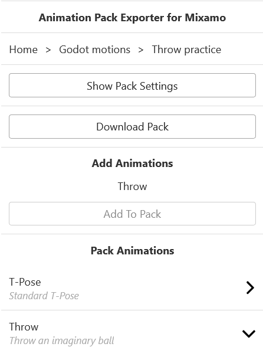

# Animation Pack Exporter for Mixamo

Choose animations in Mixamo, save them in named packs and export each pack as one ZIP. Each pack remembers its character and preview settings. This independent Firefox port builds on [Mixamo Batcher by Faris Mustafa](https://github.com/farism/mixamo-batcher). The extension code is distributed under the [MIT license](LICENSE).

## Export your first pack

1. Open [Mixamo](https://www.mixamo.com/) in desktop Firefox and sign in. If Mixamo was open when you installed the extension, reload the page. The panel uses your existing Mixamo session.
2. Preview your character. Enter a **New Project Name** in the panel and click **Create Project**. Enter a **New Pack Name** and click **Create Pack**. The pack starts with a skinned T-pose for this character.
3. Preview a motion. Once its name appears under **Add Animations**, click **Add To Pack**. Adjust supported sliders in the Mixamo preview with the pack open. Repeat for each clip you want.
4. Click **Download Pack** and keep the tab open. The panel shows which file Mixamo is preparing. Firefox saves the ZIP when all files are ready.



## Choose your export settings

Open **Show Project Settings** and look under **Download Preferences**. The settings apply to every pack in the project. To customize one clip, expand it under **Pack Animations** and enable **Override Project Preferences**. The starter T-pose has its own preferences, including **With Skin**.

| Setting | New project default | Other choices |
| --- | --- | --- |
| Format | FBX Binary | FBX ASCII, FBX for Unity, FBX 7.4, FBX 6.1, Collada |
| Frames per second | 30 | 24 or 60 |
| Keyframe reduction | None | Uniform or Non-Uniform |
| Skin | Without Skin | With Skin |
| In Place | On for supported motions | Off or Use saved Mixamo preview |

Older projects use **Use saved Mixamo preview** until you choose another motion setting. Clips without an In Place option keep their original movement.

### Play a pack in Godot

Unzip the pack into your Godot project. Use `T-Pose.fbx` for the character mesh and skeleton. Select a motion FBX in the FileSystem dock, change **Import As** to **Animation Library**, and reimport. Load that library on the character's AnimationPlayer through **Animation → Manage Animations** and play the clip. Use the same character for both exports so the bone names match. In-place walks suit movement driven by game code. Choose **Off** when the game needs the clip's authored displacement.

## Download permissions and privacy

The panel reads the active Mixamo session token and sends it to `www.mixamo.com` to request the character and exports you select. Mixamo receives the character, motion and export settings needed to generate the files. The extension fetches each file from the HTTPS address supplied by Mixamo. File requests omit cookies and the Adobe token. There is no extension analytics service or developer-operated server.

The extension has access to Mixamo and two known Mixamo storage hostnames. If Mixamo returns another HTTPS hostname, the panel pauses and displays it. Choose **Review download permission**, then **Allow host** in the new tab, and approve the Firefox prompt to continue. You can also cancel. Firefox remembers approved hosts.

## Back up projects and recover files

Projects stay in this Firefox profile. Choose **Export** on the panel's home screen for a JSON backup and **Import** to restore it. Import asks before overwriting a project with the same ID. Back up before removing the add-on or changing profiles.

If an export fails partway through, the panel names the first unfinished clip. Choose **Save partial ZIP** before leaving the panel or restarting the download. **Download Pack** retries the whole pack. The ZIP is assembled in memory. Split very large packs if Firefox runs low on memory.

## Build the extension

The release build was tested on Windows with Node.js **16.20.2**, pnpm **6.35.1** and Python **3.13.7**. Put `node`, `pnpm` and `python` on PATH. From the checkout or unpacked source archive run these commands.

```sh
pnpm install --frozen-lockfile
pnpm build
```

The output is `artifacts/animation-pack-exporter-1.3.0.xpi` and `artifacts/animation-pack-exporter-1.3.0-source.zip`. For local testing in Firefox 140 or later, open `about:debugging#/runtime/this-firefox`, select **Load Temporary Add-on** and choose the unsigned XPI. Temporary installations last until Firefox restarts.
